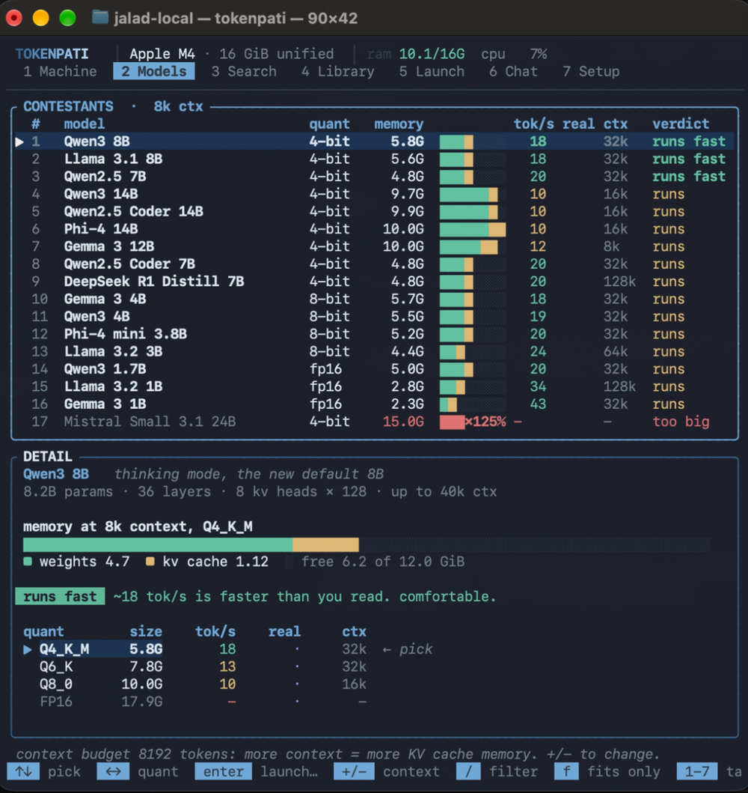

# tokenpati

**Pick the right local model for your machine, then run it.**

tokenpati reads your hardware, predicts how every model will fit and how fast it will run, picks the best model and quant, then downloads, loads and chats with it. One terminal app, every step visible.



```sh
brew install utsav1033/tap/tokenpati
tokenpati
```

Or without Homebrew: `curl -fsSL https://raw.githubusercontent.com/utsav1033/jalad-local/main/install.sh | sh`

Single binary for macOS and Linux. No Python. You don't need any engine installed first.

---

## Why

"Just run it locally" skips the hard part: you only find out whether a model works on your machine after downloading gigabytes. Then it's too big, or it runs at 2 tokens a second.

That's knowable in advance. Generation is memory-bound, so speed is roughly **memory bandwidth ÷ bytes read per token**, and whether it fits is **weights + KV cache vs. usable memory**. tokenpati does that maths for every model and quant on *your* hardware before anything downloads.

## What it does

- **Picks for you.** It ranks 21 popular models on what fits and how fast each one runs. For every model it chooses the highest quant that's still fast, and it shows why each model got its verdict.
- **Runs it.** One keypress takes you from the leaderboard to a chat. It works with **ollama**, **llama.cpp** or **mlx**. If you have none, it installs the official llama.cpp build for your GPU, without sudo.
- **Shows every step.** Engine → Weights → Load → Warm-up → Ready, each with progress, logs and timing. Downloads resume if cut off.
- **Downloads any GGUF.** Search Hugging Face, pick a size and see whether it fits before downloading. It reads the file's header (a few MB) to get the exact architecture.
- **Learns your machine.** It measures real tok/s after every run and recalibrates its predictions. `b` benchmarks your memory bandwidth instead of trusting the spec sheet.
- **Serves an API.** Loaded models are exposed on an OpenAI-compatible endpoint, so your editor, scripts and agents can use them too.

## Using it

```
 1 Machine   2 Models   3 Search   4 Library   5 Launch   6 Chat   7 Setup
```

1. **Machine** shows your chip, memory, bandwidth and the best picks. Press `enter` to launch the top one.
2. **Models** is the full leaderboard. `←→` changes quant, `+/-` changes context, and everything recalculates live.
3. `enter` opens the **launch plan**, where you can adjust engine, quant, context and GPU layers. It shows memory, speed, download size and the exact command. Nothing happens until you confirm.
4. **Launch** shows the steps as they run. When they finish, `enter` opens **Chat**.

**Search** finds any GGUF on Hugging Face. **Library** manages what's on disk, including ollama's models and LM Studio's folder. **Setup** installs and manages engines.

`?` lists every key and `,` opens settings. `q` quits, and asks first if a model is still loaded.

## Without the UI

```sh
tokenpati serve                          # download + serve the best pick, ctrl-c to stop
tokenpati serve "qwen3 8b" --quant Q5_K_M --engine llama.cpp --port 9000
tokenpati --json                         # the ranking, for scripts
tokenpati show                           # one-shot report
```

`--context 32768` budgets for a longer context.

## How it decides

| | |
|---|---|
| **Weights** | params × bytes per param at the quant × 1.1 |
| **KV cache** | 2 × layers × kv heads × head dim × context × 2 bytes |
| **Fits** | weights + KV ≤ usable memory (Apple GPUs get ~75% of unified memory; CUDA builds can spill layers into RAM) |
| **tok/s** | bandwidth ÷ (active weights + KV) × efficiency. MoE models only read active experts, which is why a 30B-A3B can beat an 8B |
| **Quant** | highest precision that's still fast, else the fastest usable one |
| **Verdict** | **runs fast** (≥18 tok/s) · **runs** (≥10) · **too big** / **too slow** |

Efficiency starts at 80% and is recalibrated from your real runs.

## Engines

| | Best for | What tokenpati does |
|---|---|---|
| **ollama** | easiest setup | pulls the model, loads it with your context size, and falls back to `hf.co/<repo>:<quant>` if ollama doesn't have that quant |
| **llama.cpp** | most control | installs `llama-server` (CPU, CUDA, Vulkan, ROCm or Metal), downloads the exact GGUF, runs it with your context and GPU layer count |
| **mlx** | Apple silicon | downloads the mlx-community weights and runs `mlx_lm.server` |

## Files and env

Everything lives in `~/.tokenpati`: models, the llama.cpp binary, logs, saved chats and settings. Delete the folder to remove everything. Override the location with `TOKENPATI_HOME`.

`HF_TOKEN` handles gated repos, `HF_ENDPOINT` points at a mirror, `OLLAMA_HOST` points at a non-default ollama, and `HTTPS_PROXY`/`NO_PROXY` are respected.

## Build from source

```sh
cargo install --git https://github.com/utsav1033/jalad-local
```

Or clone it and run `cargo run --release`, with `cargo test` for the tests.

Code map: `hardware.rs` (detection, bandwidth benchmark) · `catalog.rs` (models) · `budget.rs` + `verdict.rs` (the maths) · `gguf.rs`, `hf.rs`, `net.rs` (Hugging Face and downloads) · `engine/` (ollama, llama.cpp, mlx) · `pipeline.rs` (the launch steps) · `tui/` (the app).

To release: bump `version` in `Cargo.toml`, then `git tag vX.Y.Z && git push --tags`. CI builds the macOS and Linux binaries that `install.sh` downloads, and updates the Homebrew formula in `utsav1033/homebrew-tap` when the `HOMEBREW_TAP_TOKEN` secret is set.

MIT licensed.
